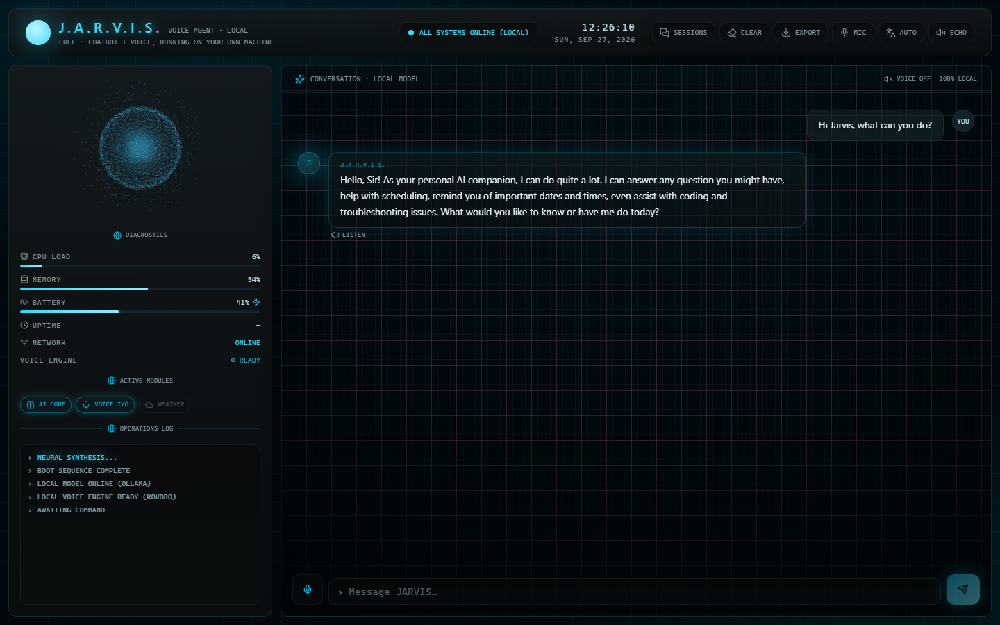

# JARVIS Demo — a free, multilingual, local-first chatbot & voice agent

[](https://alex-stark-industries.github.io/JARVIS-Demo/)
[](../../releases/latest)
[](LICENSE)
[](../../releases/latest)

**A free AI chatbot and voice assistant that runs entirely on your own computer —
and speaks your language.** Write or talk in English, Italian, Spanish, French,
Portuguese or Hindi, and Jarvis answers in text and out loud **in that same
language**, with a native voice and his trademark dry wit — with **no account, no
API key, no subscription, no cloud, and no telemetry.** Nothing you say is sent to
any server; the model runs locally through [Ollama](https://ollama.com), and the
voice runs on-device.

> **Local. Private. Free.** Download the installer, run it, and start talking — in
> whatever language you like.

This is a free taste of the larger **Jarvis** desktop assistant. It keeps just two
things — the **chat** and the **advanced voice mode** — and nothing else.

---

### Highlights

- 🌍 **Speaks your language** — Jarvis auto-detects the language you write or say and replies out loud in it, with a native accent: English, Italian, Spanish, French, Portuguese, Hindi. Fully local — no cloud translation.
- 💬 **Chat** — a local language model via [Ollama](https://ollama.com), streamed word by word as he replies.
- 🎙️ **Advanced voice mode** — a full-screen, hands-free particle sphere with neural turn detection. Hold **Space** or tap the mic; he listens, thinks, and speaks the answer back.
- 🎩 **Dry British wit** — a razor-witted butler with a deadpan sense of humour, the same character in every language.
- 🔊 **Five English voices** — pick the one you like in the header; other languages use their own native voice automatically.
- 🔒 **Private by design** — no accounts, no API keys, no telemetry. Conversations and voice stay on your machine.

---

### Screenshots

<table>
<tr>
<td width="50%">

**Chat** — the neural core, live diagnostics, and a streamed conversation with the local model.


</td>
<td width="50%">

**Advanced voice mode** — a full-screen reactive sphere with neural mic detection; hold Space or tap to talk.


</td>
</tr>
</table>

---

### Download & install

1. Open the [**Releases**](../../releases/latest) page and download
   `JARVIS-Voice-Agent-Setup-<version>.exe`.
2. Run it. The installer is **per-user** — it needs **no administrator rights**.
3. Launch **JARVIS Voice Agent** from the Start menu (or the desktop shortcut, if
   you asked for one).

> **First launch:** the installer isn't code-signed, so Windows SmartScreen may
> show *"Windows protected your PC"*. Click **More info → Run anyway**. This is
> normal for free, independent apps.

New here? The [**Welcome & Setup guide**](WELCOME.md) walks you through every step
with nothing assumed.

### One-time setup (required)

Jarvis's "brain" runs locally through **Ollama**, a free local AI engine:

1. Install [Ollama](https://ollama.com).
2. Pull the model once, in a terminal:
   ```
   ollama pull qwen2.5:3b
   ```
3. Make sure Ollama is running, then start Jarvis.

The first time you open the voice, it downloads its speech models once (a few
hundred MB) and then works offline forever.

---

### Documentation

| Document | What it covers |
|---|---|
| [Welcome & Setup](WELCOME.md) | Beginner, step-by-step: install, run, first chat, first voice |
| [Changelog](CHANGELOG.md) | What changed in each version |
| [License](LICENSE) | MIT — free to use |

---

### System requirements

Jarvis runs the AI model and the voice **on your own machine**, so what you get
depends on your PC. These are realistic minimums for the bundled `qwen2.5:3b`
model.

| | Minimum | Recommended |
|---|---|---|
| **OS** | Windows 10 / 11, 64-bit | Windows 11, 64-bit |
| **CPU** | Any modern 64-bit (x64) processor | Recent multi-core CPU |
| **RAM** | 8 GB | 16 GB |
| **Free disk** | ~4 GB (app ≈0.5 GB · model ≈2 GB · speech models ≈0.5 GB) | 6 GB+ |
| **GPU** | None — runs on CPU | A GPU with **WebGPU** support (recent NVIDIA / AMD / Intel) speeds things up |
| **Internet** | For one-time setup only (Ollama, model, first-voice download) | — |

- **[Ollama](https://ollama.com)** must be running locally with `qwen2.5:3b`
  pulled (`ollama pull qwen2.5:3b`).
- Everything else — chat and voice — runs offline once set up.
- With less RAM or no GPU, Jarvis still works; replies and speech just take longer.

---

### Privacy at a glance

- **No accounts, no API keys, no telemetry, no analytics, no auto-update.**
- The language model runs on **your own machine** through Ollama.
- The voice (speech-to-text and text-to-speech) runs **on-device**.
- The only network use is the one-time model downloads and your own prompts going
  to Ollama on your own computer.

---

### License

MIT — free to use. See [LICENSE](LICENSE). The larger **Jarvis** product this
previews is a separate, proprietary application.
